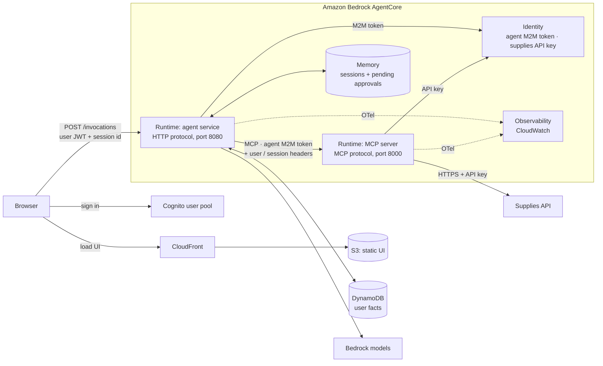

# Running on Amazon Bedrock AgentCore

<!-- DRAFT for review: written from the code and the AgentCore docs/samples (Context7, AWS docs, 2026-10).
Earlier notes are in AGENTCORE_OLD.md. -->

How this build would be deployed on AWS with Amazon Bedrock AgentCore: the target setup, the steps to get
there and the code changes. Nothing here is deployed.

The agent service already follows the AgentCore Runtime HTTP contract (the "custom agent",
[option B](https://strandsagents.com/docs/user-guide/sdk/deploy/deploy_to_bedrock_agentcore/python/#option-b-custom-agent)
in the Strands docs), so the same container runs on AgentCore Runtime. Most of the work is replacing the
local stand-ins with managed services:

| Local stand-in | On AWS |
|---|---|
| SQLite sessions and pending approvals | AgentCore Memory (short-term) |
| SQLite user facts | DynamoDB (see [Decisions](#decisions)) |
| Trusted `X-User-Id` header | Cognito JWT, validated by the Runtime |
| No auth between agent and MCP server | The agent's M2M token, validated by the MCP runtime |
| Static API key in an env var | AgentCore Identity |
| Anthropic API | Amazon Bedrock |
| otel-lgtm (Grafana) | AgentCore Observability (CloudWatch) |
| UI served by the agent service | S3 + CloudFront |

**Principle:** every change sits behind a setting, so `docker compose up` keeps working unchanged and the
same images run in both places.

## 1. Target architecture

**Two hops, two tokens.** The user's Cognito token is validated once, by the agent runtime's authorizer;
the agent takes the user id from its `sub` claim. The agent calls the MCP runtime with its **own** M2M token,
and the MCP runtime accepts only that client. The user and session travel in allowlisted custom headers that
the agent fills from the validated token and its session id, never from the model.

Why not forward the user's token to the MCP runtime: approval is enforced in the agent (the interrupt hook),
not in the MCP server. If the MCP runtime accepted user tokens, a user could call `create_purchase_order`
directly and skip the approval step. With the agent's token, the agent is the only way in. Trade-off: the MCP
server trusts the agent's word about who the user is. An on-behalf-of token exchange (one token naming both)
would close that, but AgentCore Identity's exchange needs an identity provider that implements RFC 8693 or
RFC 7523 (e.g. Okta, Entra ID); Cognito user pools don't.

**MCP server on Runtime, not Gateway.** Our MCP server holds the API mechanics (retries, idempotency keys,
errors the model can act on), so it stays. Hosting it on Runtime is the smallest step: same container, same
stateless streamable HTTP. Gateway can be added in front of it later, when other agents need these tools,
without rewriting anything. Pointing Gateway straight at the supplies API (OpenAPI target) would drop the
MCP server and everything it does, so that's not an option for this build.

## 2. Deployment steps

1. **Cognito user pool** with two app clients:
   - `ui`: authorization code + PKCE, for the browser (Cognito's managed login pages).
   - `agent`: client credentials, with a resource server scope such as `supplies-mcp/invoke`.
2. **AgentCore Identity**:
   - an OAuth2 credential provider for the `agent` client (the agent's M2M token);
   - an API key credential provider for the supplies API key.
3. **AgentCore Memory** for sessions: short-term only (no extraction strategies), event expiry 30 days
   (replaces `AGENT_SESSION_RETENTION_DAYS`).
4. **DynamoDB** table `user_facts`, partition key `user_id`, sort key `key`.
5. **Images**: build the `mcp` and `agent` images (already `linux/arm64`) and push them to ECR.
6. **MCP runtime**: protocol MCP, the `mcp` image.
   - Inbound auth: `customJWTAuthorizer` with the user pool's discovery URL, `allowedClients: [agent]`.
   - Request header allowlist: `X-Amzn-Bedrock-AgentCore-Runtime-Custom-User-Id`, `...-Session-Id`.
   - Env: `MCP_HOST=0.0.0.0`, `MCP_PORT=8000`, `MCP_API_URL`, the API key provider name, OTel settings.
7. **Agent runtime**: protocol HTTP, the `agent` image.
   - Inbound auth: `customJWTAuthorizer`, `allowedClients: [ui]`.
   - Request header allowlist: `Authorization`.
   - Env: `AGENT_MODEL_PROVIDER=bedrock`, `AGENT_MODEL_ID` (a Bedrock inference profile), the MCP runtime's
     URL, the Memory id, the facts table, the M2M provider name, OTel settings.
   - Execution role: Bedrock model invocation, Memory events, Identity tokens, the DynamoDB table, logs.
   - Lifecycle: idle timeout (default 15 min) and max lifetime (default 8 h) as defaults.
8. **Observability**: enable CloudWatch Transaction Search, so spans land in CloudWatch and show in the
   GenAI observability view.
9. **UI**: build it and publish to S3 behind CloudFront, configured with the user pool and the agent
   runtime's invocation URL.

All of this as infrastructure as code (CDK or Terraform); the evals keep running in CI against the same
agent code.

## 3. Code changes

| Area | File | Change |
|---|---|---|
| Caller identity | `agent/schemas.py`, `agent/dependencies.py` (`get_caller`) | New setting for where the user comes from: `header` (local, as now) or `jwt` (read `sub` from the `Authorization` token the Runtime already validated). The session id header is unchanged. |
| MCP connection | `agent/tools.py` (`mcp_tools`) | URL becomes the MCP runtime's invocation URL. Headers: `Authorization: Bearer <agent M2M token>` (from Identity, `@requires_access_token(auth_flow="M2M")`) and the custom user / session headers. Header names from settings. |
| MCP identity | `mcp_server/server.py` (`USER_HEADER`, `SESSION_HEADER`), `mcp_server/settings.py` | Header names from settings, so the server reads `X-Amzn-Bedrock-AgentCore-Runtime-Custom-*` on AgentCore. `allowed_hosts` set for the Runtime's `Host`. |
| Supplies API key | `mcp_server/client.py`, `mcp_server/settings.py` | Fetch the key from Identity (`@requires_api_key`) when set, cached for a short time; `MCP_API_KEY` stays for local. |
| Sessions | `memory/sessions.py` (`session_manager`) | A second backend: `AgentCoreMemorySessionManager` (actor = user, session = Runtime session id), chosen by setting. The SQLite purge doesn't run there; Memory expires events. |
| Session ownership | `memory/sessions.py` | Locally a session of another user is refused (403). In Memory, events are stored per actor, so another user's session id just opens an empty session of their own. Isolation holds; the 403 goes away on AgentCore. |
| User facts | `memory/facts.py` | A `DynamoFactStore` with the same `MemoryStore` interface and upsert per key, chosen by setting. The agent doesn't change. |
| Model | `agent/model.py` | None: `bedrock` is already a provider. Set `AGENT_MODEL_ID`, as Bedrock has no default here. |
| Telemetry | `agent/telemetry.py`, `mcp_server/telemetry.py` | On AgentCore, ADOT (`aws-opentelemetry-distro`, started with `opentelemetry-instrument`) sets up the providers and exporters. Our part shrinks to adding the caller span processors to the existing provider. |
| UI | `agent/routes.py` (`GET /`) | Serving the UI behind a setting (off on AgentCore). The UI itself: sign-in with Cognito (OIDC library), `Authorization` header on each call, the Runtime's URL. |
| Dependencies | `pyproject.toml` | `bedrock-agentcore` in the `agent` and `mcp` groups; `aws-opentelemetry-distro`; `boto3` for DynamoDB (if not already pulled in by the `bedrock` extra). |
| Containers | `Dockerfile`, entrypoints | MCP image on port 8000 at `/mcp` (via env). Both started with `opentelemetry-instrument` on AgentCore. |

No change to the agent's logic: the prompt, the approval hook, the idempotency keys, the retries and the
streaming path stay as they are.

## Decisions

- **User facts in DynamoDB, not AgentCore long-term memory.** Our facts are a closed set of keys with one
  value each, written only by the `remember_fact` tool. AgentCore long-term memory is built around records
  *extracted* by strategies (semantic, user preference, summary), which is the free-text capture we chose
  not to do. A small table keeps the closed set and the upsert. If a `MemoryStore` backed by AgentCore Memory
  that writes records directly turns up, it's a swap behind the same interface.
- **Keep the per-session lock and the per-request MCP connection.** Runtime gives each session its own
  microVM, so they could be simplified (one lock, one connection per session). Not worth a second code path
  until it's confirmed that Runtime serialises requests for one session.
