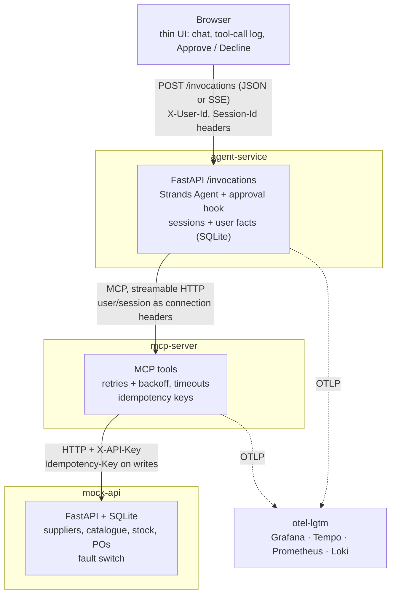
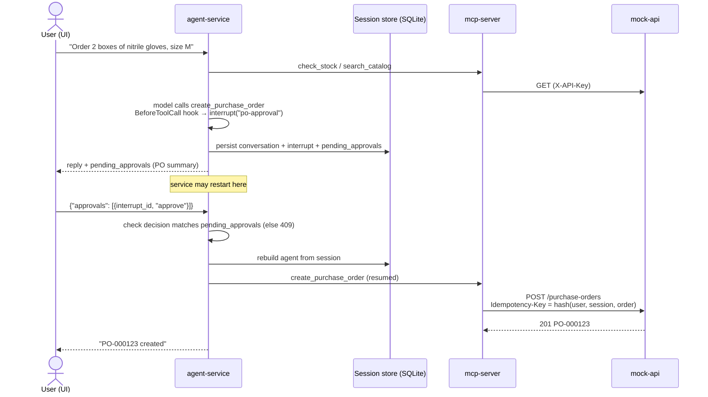

# Lab Supplies Agent

The Lab Supplies Agent lets scientists order reagents and consumables in plain language through a web UI. It checks what's in stock, searches the catalogues of approved suppliers and proposes a purchase order. The order is created only after the user approves it.

A mock API stands in for the supplies backend (suppliers, catalogue, stock and purchase orders) and is the single source of truth for that data. The agent never calls it directly: it goes through an MCP server that exposes the backend as tools, authenticates to it with an API key, and handles retries, backoff, timeouts and idempotency keys. That keeps the agent focused on decisions and talking to the user, while the MCP server makes the backend calls reliable and safe to repeat.

Through the web UI a user can:

- check the stock of lab supplies
- search approved suppliers' catalogues
- ask for an order and review the proposed purchase order, with every tool call shown
- approve or decline it
- have their lab, team and delivery location remembered across sessions

> **Scope:** this project is a demo, built to run locally with `docker compose up`. Several choices only make sense locally:
> SQLite for sessions, memory and the mock backend; the user taken on trust from an `X-User-Id` header; a fixed development
> API key between the MCP server and the mock; and a mock in place of real supplier systems. The agent service already
> follows the AgentCore Runtime HTTP contract, so the same container runs on both.
> [AGENTCORE.md](AGENTCORE.md) proposes a production architecture on Amazon Bedrock AgentCore and what would change to get there.

**Demo video:** [one run, from a proposed order through a failure handled to its trace in Grafana](docs/media/debugging-a-bad-run.mp4) (5 min). It walks through the scenario in [§7.2](#72-debugging-a-bad-run).

## Contents

1. [Quick start](#1-quick-start)
2. [Architecture](#2-architecture)
3. [Agent design](#3-agent-design)
4. [Tool design](#4-tool-design)
5. [Failure handling](#5-failure-handling)
6. [Quality](#6-quality)
7. [Observability](#7-observability)
8. [Key decisions](#8-key-decisions)
9. [Engineering standards](#9-engineering-standards)
10. [How I used AI tools](#10-how-i-used-ai-tools)
11. [What I'd do with more time](#11-what-id-do-with-more-time)

- [Appendix](#appendix)

---

## 1. Quick start

**Prerequisites:** Docker (with Compose) and an Anthropic API key.

```bash
cp .env.example .env            # set ANTHROPIC_API_KEY
docker compose up --build       # or: make docker-up
```

| What                                             | Where                              |
| ------------------------------------------------ | ---------------------------------- |
| Web UI (chat, tool calls, Approve / Decline)     | http://localhost:8080              |
| Grafana: dashboard, traces, logs (admin / admin) | http://localhost:3000              |
| Mock API fault switch                            | http://127.0.0.1:8001/admin/faults |

**Turn failures on** (rates are probabilities from 0 to 1):

```bash
curl -X PUT http://127.0.0.1:8001/admin/faults \
  -H 'X-API-Key: dev-mock-key' -H 'Content-Type: application/json' \
  -d '{"rate_limit_rate": 0.3, "server_error_rate": 0.3, "slow_rate": 0.2, "slow_seconds": 5}'
```

Send all zeros to turn them off again. All fault settings: [docs/SUPPLIES_API.md](docs/SUPPLIES_API.md#fault-injection).

**Without Docker** (needs [uv](https://docs.astral.sh/uv/) and Python 3.12+):

```bash
cp .env.example .env   # set ANTHROPIC_API_KEY (skip if done)
uv sync                # install dependencies

# then each service in its own terminal, in this order:
make api               # mock API    → 127.0.0.1:8001
make mcp               # MCP server  → 127.0.0.1:8002/mcp
make agent             # agent + UI  → http://127.0.0.1:8080
```

This setup has no Grafana: telemetry is exported only when `OTEL_EXPORTER_OTLP_ENDPOINT` is set (compose sets it), so traces and metrics are off and logs go to the console only.

**Tests and evals:**

```bash
make test          # pytest, no LLM calls
make eval          # all eval cases (needs ANTHROPIC_API_KEY) → evals/results/latest.json
make eval-report   # the same, plus an HTML report → evals/results/latest.html
make lint
```

`make` on its own lists all targets.

## 2. Architecture



The four services run from one `docker-compose.yml`. The agent reaches the mock **only** through the MCP server. The MCP server isn't published outside the compose network. The agent service and the MCP server export traces; the mock only logs to the console.

Each service's interface, with examples, responses and errors: [Agent API](docs/AGENT_API.md), [MCP server](docs/MCP.md), [Supplies API (mock)](docs/SUPPLIES_API.md).

**Approval flow, including a restart:**



**Assumptions.** The demo assumes a supplies API already exists, and the task is to add an agent on top of
it. The mock stands in for that API as a separate HTTP service, and the MCP server connects to it like any
client would, with its own API key. The connection from the agent service to the MCP server has no
authentication: it was left out to keep the focus on the integration. The options for a production deployment
are in [AGENTCORE.md](AGENTCORE.md).

## 3. Agent design

### 3.1 Framework and model

**Framework.** I considered Strands Agents, LangGraph and PydanticAI, and chose **Strands Agents** because:

- I'm already familiar with it, and its documentation is good.
- Its hooks and interrupts fit the approval step: a hook on `create_purchase_order` pauses the run until the user decides (see [3.2](#32-orchestration-and-the-approval-step)).
- It has building blocks for both kinds of memory: session managers for conversation history and a memory SDK for long-term facts (see [3.3](#33-memory)).
- It works well on AgentCore Runtime, and AWS publishes many Strands examples for it.

**Evals.** I used the Strands Evals SDK (`strands-agents-evals`), which fits the same agent. It provides the building blocks to define and run cases against agent behaviour, and built-in evaluators, both deterministic and LLM-as-a-judge (see [6.1](#61-eval-cases)).

**Model.** Anthropic is the default (`claude-sonnet-5-5` through Strands' `AnthropicModel`). The provider and model id are config (`AGENT_MODEL_PROVIDER`, `AGENT_MODEL_ID`), and one factory function builds the model (`agent/model.py`). Amazon Bedrock is the other supported provider; adding another means one more branch there. The eval judge uses a cheaper model (`claude-haiku-5-5`).

The default model is a personal preference, not the result of a comparison. With more time I'd run the evals
against several models, cheaper ones included, and choose on measured performance and cost (see
[§11](#11-what-id-do-with-more-time)).

### 3.2 Orchestration and the approval step

- One `POST /invocations` runs one agent invocation: Strands runs as many model ↔ tool cycles as it needs.
- A `BeforeToolCallEvent` hook on `create_purchase_order` raises a Strands **interrupt** with the PO summary. The invocation ends with `stop_reason == "interrupt"`, and the session manager persists the conversation, agent state and interrupt to SQLite. **The pending approval survives a restart.**
- The user's next request carries `{"approvals": [{"interrupt_id", "decision"}]}` from the UI buttons. The agent is rebuilt from the session store and the hook resumes: approve lets the tool run, decline cancels it.
- Approval is **structured, never inferred**. A free-text "yes" while an order waits gets a 409 with the pending list; the model is never asked whether the user approved. A decision for the wrong id, or when nothing is pending, also gets a 409.
- Every PO is approved on its own; approval is never remembered for later orders.
- One invocation per session at a time (a session lock; a concurrent request gets a 409).

**Why interrupts rather than a hand-rolled "pending" state:**

- **The approved order is the order that runs.** An interrupt pauses the model's actual tool call. On
  approve, that same call resumes with the same input, so the user approves exactly what gets executed.
  With a hand-rolled pending state, the model would have to call the tool again after approval and could
  send a different order from the one the user saw.
- **Persistence for free.** The interrupt is saved in the session together with the conversation, by the
  same session manager, so the conversation and the pending approval can't drift apart, and both survive
  a restart. We keep only a small mirror (`pending_approvals` in agent state) to refuse wrong requests
  before the agent runs.
- **Framework-native.** It's how Strands supports human-in-the-loop, so there's less custom code. Strands saves
  the interrupt as part of the agent's session record, and AgentCore Memory's session manager stores that
  whole record, so pending approvals should carry over (from reading the code; not tested on AgentCore).

**Why structured approval:** the decision is too important to depend on how the model reads a chat
message ("yes, but only one box" is not an approval). A button sends an explicit decision tied to a
specific `interrupt_id`, which the model can't produce or fake. See the approval entry in
[§8](#8-key-decisions).

### 3.3 Memory

| Layer      | What                                                                        | Where                                                                                           | How long                                                               | Who                                                                                                     |
| ---------- | --------------------------------------------------------------------------- | ----------------------------------------------------------------------------------------------- | ---------------------------------------------------------------------- | ------------------------------------------------------------------------------------------------------- |
| Short-term | Conversation history, agent state, pending approvals                        | SQLite (`data/agent.db`) through our `SessionRepository` in Strands' `RepositorySessionManager` | Purged after 30 days without activity (`AGENT_SESSION_RETENTION_DAYS`) | One `(user_id, session_id)`; a session owned by another user gets a 403                                 |
| Long-term  | User facts: `lab`, `team`, `delivery_location` (closed set, one value each) | SQLite `user_facts` table, through the Strands memory SDK (`SqliteFactStore`)                   | Until overwritten                                                      | One `user_id`; the store is bound to the caller per request, and no tool takes a user id from the model |

- Facts are written only by the `remember_fact(key, value)` tool.
- When the user has saved facts, the Strands `MemoryManager` adds them to the model input on every model call,
  as a `<memory>` block appended to the latest user message:

  ```xml
  <memory>
  <entry source="user_profile">lab: LAB A</entry>
  <entry source="user_profile">team: TEAM ALPHA</entry>
  </memory>
  ```

  The block is ephemeral: the model sees it for that one call, but it's never written to the conversation
  history or the session store. It does show in the model call's input in the trace.
- Every order needs a delivery location. The agent uses the saved one or asks once and saves the answer. A location given for a single order doesn't replace the saved one.
- The split mirrors AgentCore Memory's short-term / long-term split (see [AGENTCORE.md](AGENTCORE.md)).

**Why a closed set of facts.** I wanted the model to remember only what ordering needs: lab, team and
delivery location. Writes go through one tool, `remember_fact`, whose `key` is limited to those three, and the
SDK's free-text `add_memory` tool and [automatic extraction](https://strandsagents.com/docs/user-guide/sdk/memory/managing-memory/#automatic-extraction)
are off. Extraction would let a model decide in the background what to keep, limited only by a prompt. That
is a real risk of over-collecting in PII-sensitive environments. With a closed set, the model can't store
anything else, every save is a visible tool call, and a new value replaces the old one. Known gap: the
values are free text, so the model could still put personal data in one.

**Retention.** Sessions are purged after 30 days without activity. That's a configurable default
(`AGENT_SESSION_RETENTION_DAYS`), not a tuned value. User facts are kept until overwritten.

## 4. Tool design

### 4.1 Tools

| Tool                    | Kind                                       | Purpose                                                 |
| ----------------------- | ------------------------------------------ | ------------------------------------------------------- |
| `check_stock`           | read                                       | What's on hand, by name or SKU fragment                 |
| `search_catalog`        | read, paginated (`page`, `page_size` ≤ 20) | Approved suppliers' items, by words, SKU or category    |
| `get_catalog_item`      | read                                       | One item by SKU                                         |
| `create_purchase_order` | write (behind approval)                    | Lines of `{sku, quantity}` plus a required `deliver_to` |
| `remember_fact`         | agent-local                                | Save `lab` / `team` / `delivery_location` for this user |

The MCP tools carry MCP annotations (`read_only_hint`, `idempotent_hint`). Arguments have tight schemas (bounds, lengths, enums for category) with an example in each description, e.g. `'BL-PBS-500'`. Full tool reference, with real calls and results: [docs/MCP.md](docs/MCP.md#tools).

Tool names are verb_noun and use the user's own words (`check_stock`, `search_catalog`,
`create_purchase_order`). Each description says when to use the tool and what to do next, e.g. "Use this
first…" or "if total_pages is greater than page, call again with the next page".

I tested the flow by hand many times and ran the evals repeatedly, and didn't see the model misuse a tool,
so the names and descriptions stayed as first written. The system prompt (~500 tokens) still repeats some
of what the tool descriptions and error messages say (check stock first, one supplier per order, ask for a
delivery location, don't retry when the system is down). With more time I'd remove those lines and use the
evals to see whether the tool descriptions alone are enough.

### 4.2 How errors reach the model

Tool errors are written as instructions the model can act on, not as raw HTTP errors:

- **Bad input** (unknown SKU, etc.): the mock's message is passed through, e.g. _"No purchase order 'X'. PO numbers look like PO-000001."_
- **Backend unavailable** after retries: _"The supplies system is unavailable right now (4 attempts; last error: HTTP 503). Do not retry now. Tell the user you could not complete the request…"_. For a write it adds that the order may or may not have been recorded, and that placing the same order again is safe.
- **Our credentials rejected** (401/403): the model is told to report a misconfiguration; there's nothing it can fix.

Every error message: [docs/MCP.md](docs/MCP.md#errors).

### 4.3 Auth to the supplies API

- MCP server → mock: an `X-API-Key` header on every request (`MCP_API_KEY` / `API_KEY`, set from `MOCK_API_KEY` in compose). Missing or wrong key → 401 ([docs/SUPPLIES_API.md](docs/SUPPLIES_API.md#authentication)).
- Agent service → MCP server: the caller's `user_id` and `session_id` travel as connection headers set by the service, never by the model. The MCP server uses them for idempotency keys.
- Known gap: the local version trusts `X-User-Id`. On AgentCore the user would come from a validated JWT.

## 5. Failure handling

- **Fault switch** on the mock (`PUT /admin/faults`): random 429 (with `Retry-After`), 503 and slow responses, each with its own probability. A 503 on a write is returned _after_ the write commits, the hardest case for duplicates.
- **Retries** live in the MCP server's API client: 429, 5xx, connection errors and slow attempts are retried with exponential backoff and jitter, honouring `Retry-After`. The limits are 4 attempts, 3 s per attempt and 15 s in total (`MCP_MAX_ATTEMPTS`, `MCP_ATTEMPT_TIMEOUT`, `MCP_TOTAL_TIMEOUT`).
- **Giving up:** after that, the tool returns the "unavailable" error above and the agent tells the user.
- Retry rules and a worked example of a write that commits but reports a 503: [docs/MCP.md](docs/MCP.md#retries-and-timeouts).
- **Never the same PO twice:** every create carries an `Idempotency-Key = sha256(user_id, session_id, normalized order)`, derived by the MCP server, and the mock deduplicates on it.

Why the key is built from the order and not the tool call, and the trade-off that comes with it: see
[§8 Key decisions](#8-key-decisions).

## 6. Quality

### 6.1 Eval cases

`make eval` runs every case with the Strands Evals SDK. The agent is tested in isolation: the real model, prompt, approval hook and fact store, with fake supplies tools that use the MCP server's real tool definitions and error wording. A contract test keeps the fakes in line with the real tools. Integration guarantees (409s, session isolation, no duplicate POs under faults) are covered by pytest.

| Group        | Case                                                                               | Checks                                                       |
| ------------ | ---------------------------------------------------------------------------------- | ------------------------------------------------------------ |
| Tool choice  | `tool-stock-check`, `tool-catalogue-search`                                        | right tool called, trajectory (LLM judge), no order proposed |
| Approval     | `approval-proposal-stops`, `approval-approve`, `approval-decline`                  | PO proposed and stopped; placed only on approve              |
| Out of scope | `scope-poem`, `scope-travel`                                                       | no tools called; refusal wording (LLM judge)                 |
| Failures     | `failure-read-outage`, `failure-write-outage`                                      | nothing placed; user told about the outage (LLM judge)       |
| User facts   | `facts-collect-delivery-location`, `facts-one-off-location`, `facts-remember-team` | right facts saved, one-off location not saved                |

Evaluators: deterministic first (`StateEquals`, `ToolCalled`), LLM judges (`TrajectoryEvaluator`, `OutputEvaluator` on `claude-haiku-5-5`) only where an exact check can't decide.

**How a run works.** `python -m evals` runs one Strands Evals `Experiment` per group, one case at a time. For
each case the task (`evals/task.py`):

1. Builds a fresh agent, as the service does (real model, system prompt, approval hook), with a fact store
   on a temporary SQLite file and the fake supplies tools.
2. Sets the scene from the case's metadata: facts already saved, stock overrides, tools that should fail.
3. Sends the message, then any follow-up messages. If the agent proposed an order and the case has a
   decision, it resumes the interrupt with that decision, as the UI's buttons do.
4. Reports the reply, the tool trajectory and four end states: `tools_called`, `proposed_orders`,
   `orders_placed`, `saved_facts`.

The group's evaluators then compare those with what the case expects. All options are in the
[appendix](#evals).

### 6.2 Latest results

12 cases, 28 evaluator checks, all passing (overall score 1.0).

`make eval` writes the raw results to [`evals/results/latest.json`](evals/results/latest.json). `make eval-report`
runs the evals and then turns those results into a human-readable HTML report,
[`evals/results/latest.html`](evals/results/latest.html): one entry per case, grouped by type, with each
evaluator's verdict, the expected and actual tool trajectory, the agent's output and its end state.

**Known issue.** In some runs the judge flagged outage replies that mention technical details such as
"HTTP 503". The cause is the MCP server's "unavailable" error, which includes the last error
(`4 attempts; last error: HTTP 503`), and the model sometimes repeats it to the user. I didn't have time to fix
it. The fix belongs in that error message (keep the details in the logs, not in what the model sees) or a
line in the system prompt, checked with the `failure-` evals.

### 6.3 What the evals don't catch yet

- **One run per case.** Model output varies from run to run, and a single pass gives no pass rate. The
  "HTTP 503" issue in [6.2](#62-latest-results) shows up only in some runs. Running each case several times
  with a pass threshold would catch flaky behaviour.
- **No full-path run.** The supplies tools are fakes, so no eval sees real retries, slow responses (a tool call
  can take up to 15 s), or the HTTP and session layers with a live model. Those are covered by pytest without a
  model (see the evals entry in [§8](#8-key-decisions)).
- **No adversarial cases.** Nothing tests a user telling the agent to approve its own order, instructions
  hidden in tool data (e.g. a catalogue item name), a `remember_fact` value used to plant instructions, or a
  request to order from the unapproved supplier.

### 6.4 Guardrails

The guardrails are mostly in code, around the one action that matters: creating a PO.

- **In code (always enforced):** no PO without the user's explicit approval; no order without a delivery
  location; tight tool schemas (quantity 1–1000, at most 20 lines), validated again by the API; only approved
  suppliers' items can be ordered; identity and idempotency keys never come from the model; a closed set of
  memory keys; sessions isolated per user.
- **In the prompt (usually followed):** stay in scope, never invent SKUs or prices, treat saved facts as data.
- **Not yet:** no guard model screening input or output (prompt injection, PII). On AWS, Amazon Bedrock
  Guardrails would be the natural addition.

## 7. Observability

### 7.1 What's traced

OpenTelemetry from the agent service to Grafana `otel-lgtm` (on when `OTEL_EXPORTER_OTLP_ENDPOINT` is set, as in compose):

- **Traces:** one per `/invocations`. The root HTTP span, then Strands' agent, cycle, model (`chat`: tokens, latency) and tool spans (arguments, results, errors). `user.id` and `session.id` are stamped on every span via baggage.
- **Metrics:** tokens, cycles, model latency, tool calls/errors/duration, HTTP request duration, plus a `supplies.approvals` counter (proposed / approved / declined).
- **Logs:** structured, exported to Loki with `trace_id` / `span_id`, so a log line links to its trace. They hold ids and events, not message content.
- **Dashboard:** provisioned as the Grafana home page (`deploy/grafana/supplies-agent.json`). The recent-requests
  table and the logs filter by user and session id (the web UI's copy button gives the full session id).
  Metric panels show all users: per-session labels on metrics would create a series per conversation.
- **MCP server:** its `tools/call` span joins the agent's trace (trace context and caller ids travel in the
  request's `_meta`), with one child span per attempt to call the supplies API: attempt number, HTTP status,
  and the `X-Fault-Injected` header when the mock injected the failure. Its logs stay on the console (with
  the trace id); the mock exports nothing yet.

### 7.2 Debugging a bad run

**Video:** [the whole scenario, from the failed order to the MCP attempt spans](docs/media/debugging-a-bad-run.mp4) (5 min)

**Scenario.** User `alice` orders 2 boxes of nitrile gloves, and the agent proposes the order. Before she
approves, server errors are switched on (`PUT /admin/faults` with `{"server_error_rate": 1}`). She approves:
every attempt gets a 503, and the agent says the order couldn't be confirmed. With faults off again, she asks
for the same order in the same session and approves it.

1. **Start at the dashboard.** "Tool errors" goes up, "Tool errors per minute, by tool" points at
   `create_purchase_order`, and "Purchase orders" shows an *approved* outcome with no PO. (Strands also counts
   a tool call paused for approval as a tool error, so one error next to *proposed* is normal.)
2. **Narrow to the session.** Paste the session id (the copy button next to it in the UI) into the
   `session_id` variable. The logs panel shows only this conversation's lines, each with its `trace_id`.
3. **Open the trace.** From "Recent requests" or a log line's trace link: `POST /invocations` → agent →
   cycles → `chat` model spans and the `create_purchase_order` tool span, which has error status.
4. **Read the spans.** The tool result holds the MCP server's error: *"…unavailable right now (4 attempts;
   last error: HTTP 503)… The order may or may not have been recorded."* The span's duration shows the
   time spent retrying. The next `chat` span shows how the model put this to the user.
5. **Confirm no duplicate.** In the second attempt's trace, the tool result says *"This order was already
   recorded… No duplicate was created."*: the first attempt had committed despite the 503.
6. **See the retries.** Under the `create_purchase_order` tool span, the MCP server's `tools/call` span has
   one `supplies API POST` child per attempt, each with status 503 and `supplies.fault_injected:
   server_error_after_write`: the first attempt committed the order and the others replayed it, but
   the client only saw failures.

## 8. Key decisions

**FastAPI instead of `BedrockAgentCoreApp`.** The agent service is a plain FastAPI app that follows the
AgentCore Runtime HTTP contract (`POST /invocations`, `GET /ping`, port 8080, `linux/arm64`), the
"custom agent" deployment option in the [Strands docs](https://strandsagents.com/docs/user-guide/sdk/deploy/deploy_to_bedrock_agentcore/python/#option-b-custom-agent).

- *Why:* FastAPI's dependency injection wires each request (caller identity, session lock, MCP connection,
  model, agent) and manages their lifecycle within the request. The same app serves the web UI, so there
  are no CORS issues locally. Tests replace the model and tools through `dependency_overrides`, so they
  run without LLM calls. Expected errors become proper HTTP statuses (403 / 409 / 503) before a stream
  starts. FastAPI's OpenTelemetry support gives a root span per request.
- *Trade-off:* we implement and maintain the Runtime contract ourselves, without `BedrockAgentCoreApp`'s
  automatic server setup or the `agentcore` CLI workflow.

**Approval is enforced by the harness, not decided by the model.** The model can *propose* an order by
calling `create_purchase_order`, but it has no part in approving it. It can't reason its way past the
approval step, skip it, or fake one.

- A `BeforeToolCallEvent` hook in the agent service intercepts every `create_purchase_order` call and
  raises a Strands interrupt before the tool runs. The hook runs in code, outside the model's control.
- The decision only arrives as structured data in the user's next request (`approvals`, sent by the UI's
  Approve / Decline buttons), turned into `interruptResponse` blocks by the service. Nothing the model
  outputs can produce one, and a typed "yes" is never interpreted as approval.
- The flow is deterministic: while an order waits, the session accepts nothing but a decision on it (any
  other request gets a 409), so the model can't propose another order until this one is decided. If one
  reply proposes several orders, each gets its own interrupt and its own decision.
- Every order is approved on its own; an approval is never remembered for later orders.

- *Why:* the only write in the system must not depend on how the model reads a conversation. Strands
  interrupts give this out of the box, and the session manager persists them, so a pending approval
  survives a restart.
- *Trade-off:* the approval is less conversational: the user must click (or send a structured decision),
  and the session is blocked until they do.

**API mechanics live in the MCP server, not the agent.** The MCP server absorbs everything about talking
to the supplies API: authentication (`X-API-Key`), retries with backoff and `Retry-After`, per-attempt and
overall timeouts, idempotency keys, and the caller's identity from connection headers. What reaches the
agent is either a clean result or an error that tells the model what to do next, e.g. *"Do not retry now.
Tell the user you could not complete the request…"*.

- *Why:* integrating with an external system is a deterministic job, so it belongs in code, not in the
  model's reasoning or the system prompt. This keeps the agent and the API decoupled and makes the
  integration reusable: if another agent needs the same API, it connects to the same MCP server instead
  of encoding access patterns and error handling in its own prompt.
- *Trade-off:* the agent can't see or influence transient failures: a call that succeeds on its third
  attempt looks like a slow tool call. The retries are visible to us, though: each attempt is a span in
  the request's trace.
  A tool call can also take up to the overall timeout (15 s) before the model hears anything.

**Memory through Strands' interfaces; SQLite is only the storage.** Both memory layers are built on the
interfaces Strands provides, and SQLite is just where they persist:

- *Short-term* (conversation, agent state, pending approvals): our `SqliteSessionRepository` implements
  Strands' `SessionRepository`, and Strands' own `RepositorySessionManager` does the rest.
- *Long-term* (user facts): our `SqliteFactStore` implements the Strands memory SDK's `MemoryStore`, and a
  `MemoryManager` injects the profile into the model input and routes writes to it.

The split mirrors AgentCore Memory's short-term / long-term memory.

- *Why:* the agent code never touches SQLite, only the Strands interfaces, so the storage can be swapped
  without changing the agent. On AgentCore, `AgentCoreMemorySessionManager` builds on the same
  `RepositorySessionManager` base and replaces the session layer, and facts would move to a `MemoryStore`
  backed by AgentCore Memory (see [AGENTCORE.md](AGENTCORE.md)). Locally, SQLite needs no extra service and
  survives restarts.
- *Trade-off:* SQLite is a local-only choice: one file on one machine, no sharing across instances. That's
  fine for a demo and wrong for production, where AgentCore microVMs have only temporary disk.

**Idempotency key from the order itself, derived by the MCP server.** Every `create_purchase_order` call
carries `Idempotency-Key = sha256(user_id, session_id, order)`, where the order is normalized (lines
sorted by SKU, plus `deliver_to`). The MCP server derives it, never the model, and the mock deduplicates
on it: a repeated key returns the existing PO instead of creating a new one.

- *Why:* the key has to be the same however the order is retried. A key built from the tool call
  (`session_id` + `toolUseId`) breaks in the worst case: the write commits, the client sees a 503 and
  gives up, and the user asks again. That's a new tool call, so a new key and a duplicate PO. A key built
  from the order is the same on every attempt, with no extra state to store.
- *Trade-off:* an intentional repeat of the same order (same items, quantities and delivery location) in
  the same session is treated as a duplicate: the existing PO comes back, and the model is told no new
  order was created. A new session, or any change to the order, places it. I accept that rather than
  adding another mechanism to tell retries from repeats, e.g. keys tied to the approval and a shared
  store to reconcile them across instances, which would add more complexity than this case is worth.

**Evals test the agent in isolation, with fake supplies tools.** The eval task builds the real agent (real
model, system prompt, approval hook, fact store on a temporary SQLite) and calls it directly, without the
HTTP service, the MCP server or the mock. The supplies tools are fakes (`evals/fake_supplies.py`) that use
the MCP server's real tool definitions (names, descriptions, schemas, read in-process), its result models
and its error messages, with data from the mock's seed. Each case sets what the tools return: stock
levels, or which tools fail as if the backend were down.

- *Why:* evals measure the model's behaviour (tool choice, respecting the approval, refusing, explaining an
  outage), so everything else should be fixed and repeatable. A case that needs an outage gets one every
  time, instead of depending on the random fault switch, and the evals run without the services. A
  contract test (`tests/evals/test_fake_supplies.py`) runs the same calls against the fakes and the real
  MCP tools and fails if their definitions or results differ. What isn't model behaviour (409s, session
  ownership, user isolation, retries, no duplicate POs under faults) is covered by pytest.
- *Trade-off:* no eval exercises the full path (HTTP service → MCP → mock) with a live model, so the
  "failures on" cases simulate an outage at the tool level rather than going through the mock's fault
  switch and the MCP server's retries. Those are tested by pytest, without a model.

**Streaming and JSON from one endpoint.** Streaming is the optional extra. To stay on the AgentCore Runtime
contract, there is no separate streaming endpoint: `POST /invocations` returns JSON by default, and a
client opts in to server-sent events with `Accept: text/event-stream`. The stream sends `text` deltas,
`tool_start` / `tool_end` as tools run, and ends with `done` (the same response body as the JSON path) or
`error`.

- *Why:* one endpoint keeps the AgentCore contract intact (AgentCore Runtime passes SSE responses from
  `/invocations` through), and existing clients (tests, evals, curl) keep getting plain JSON. Both paths run
  the same invocation code, so they can't drift apart. Requests that will be refused (403, 409, 503) are
  still refused with a real HTTP status, before the first byte is streamed.
- *Trade-off:* once the stream has started, the 200 is already sent, so a failure mid-invocation can only
  arrive as an `error` event, and clients must handle both. Streaming also runs the invocation in a worker
  thread that owns the session lock and MCP connection, so a client that disconnects mid-stream can't leave
  the session locked. That's more moving parts than the JSON path.

## 9. Engineering standards

**Followed**

- **Clear layering, enforced by a test.** The mock, the MCP server, the agent and memory are separate packages
  that talk only over their real interfaces (HTTP, MCP). `tests/test_layers.py` fails if one imports another
  it shouldn't.
- **One concern per module**, with FastAPI dependency injection wiring each request.
- **Tests without LLM calls.** About 160 pytest tests use a scripted fake model, plus a contract test that keeps
  the eval fakes in line with the real MCP tools.
- **Typed settings** with pydantic-settings, configured through env vars only (documented in `.env.example`).
- **Lint and format** with ruff (`make lint`, `make format`).
- **Structured logging** (events and ids, never message content), plus OpenTelemetry traces and metrics.
- **One command per task:** `make test`, `make eval`, `make lint`, `make docker-up`.

**Skipped**

- **No CI pipeline.** Lint, tests and evals run locally only. A GitHub Actions workflow running `make lint test`
  would be the first addition.
- **No static type checker** (mypy or pyright), although the code is type-annotated.
- **No coverage measurement or pre-commit hooks.**
- **Lean tests on purpose.** They cover behaviour and guarantees (approval, isolation, idempotency, retries),
  not logging or wiring; logging is checked by hand in a smoke run.

## 10. How I used AI tools

I used Claude Code as a coding agent. I gave it the high-level picture and grounded it with a few rules:

- **Context first.** The brief, the architecture and every design decision live in `CLAUDE.md`, and the plan and
  progress in [`docs/PLAN.md`](docs/PLAN.md). The agent reads both at the start of a task and ticks items off,
  so each session starts from the same picture.
- **No commits without my approval.** The agent leaves changes in the working tree; I review and commit. It
  also doesn't run `uv` commands (adding dependencies, syncing); it proposes them and I run them.
- **Current docs, not training data.** For Strands, MCP and other libraries, the agent fetches up-to-date
  documentation through the Context7 MCP server instead of relying on what it remembers. These APIs change
  quickly.
- **Lean modules.** One responsibility per module where possible.

As the code grew, I steered it towards FastAPI's dependency injection and dependency inversion, so that each
request's parts (model, tools, stores) are wired in one place and can be swapped in tests.

I built early versions of the mock API and the MCP server quickly, then split the agent into small
deliverables, each adding a bit more value on top of a working system.

Once observability was in place, I ran specific scenarios and asked Claude to review their traces with me:
whether anything needed fixing, and where the flow should be adjusted. For example, the model spans in Grafana
showed the user's saved facts arriving as a `<memory>` block in the model input. Checking that against the
Strands source confirmed the block is added on every model call but never written to the conversation
history (see [3.3](#33-memory)).

## 11. What I'd do with more time

- **A real auth flow:** Amazon Cognito running in LocalStack, so users sign in and the agent service takes the
  user from a validated JWT instead of trusting the `X-User-Id` header.
- **Evals across more models**, cheaper ones included, to choose the default on measured quality and cost
  rather than preference.
- **A smaller system prompt:** remove the lines that repeat the tool descriptions and use the evals to see
  whether the descriptions alone are enough.

---

## Appendix

### Configuration

| Variable                                                                              | Default                      | Used by                       |
| ------------------------------------------------------------------------------------- | ---------------------------- | ----------------------------- |
| `ANTHROPIC_API_KEY`                                                                   | (required)                   | agent, evals                  |
| `AGENT_MODEL_PROVIDER`                                                                | `anthropic` (or `bedrock`)   | agent                         |
| `AGENT_MODEL_ID`                                                                      | `claude-sonnet-5-5`          | agent                         |
| `AGENT_MCP_URL`                                                                       | `http://127.0.0.1:8002/mcp`  | agent                         |
| `AGENT_DB_PATH`                                                                       | `data/agent.db`              | agent                         |
| `AGENT_SESSION_RETENTION_DAYS`                                                        | `30`                         | agent                         |
| `MOCK_API_KEY`                                                                        | `dev-mock-key`               | compose → MCP server and mock |
| `MCP_MAX_ATTEMPTS` / `MCP_ATTEMPT_TIMEOUT` / `MCP_TOTAL_TIMEOUT` / `MCP_BACKOFF_BASE` | `4` / `3.0` / `15.0` / `0.5` | MCP server                    |
| `EVAL_JUDGE_MODEL_ID`                                                                 | `claude-haiku-5-5`           | evals                         |
| `LOG_LEVEL` / `STRANDS_LOG_LEVEL`                                                     | `INFO` / `WARNING`           | all                           |

### API contract

`POST /invocations` and `GET /ping` follow the AgentCore Runtime HTTP contract (port 8080). Identity travels in
the `X-User-Id` and `X-Amzn-Bedrock-AgentCore-Runtime-Session-Id` headers; the body is a `message` or
`approvals`. Add `Accept: text/event-stream` to stream.

```bash
curl -s localhost:8080/invocations \
  -H 'X-User-Id: alice' -H 'X-Amzn-Bedrock-AgentCore-Runtime-Session-Id: s1' \
  -H 'Content-Type: application/json' -d '{"message": "Do we have PBS in stock?"}'
```

Full reference (responses, streaming events, every error): [docs/AGENT_API.md](docs/AGENT_API.md).

### Evals

```bash
make eval                                   # all cases → evals/results/latest.json
make eval-report                            # the same, plus evals/results/latest.html
uv run python -m evals --case approval-     # only cases whose name contains "approval-"
uv run python -m evals --case scope --case facts-remember   # --case can be repeated
```

The command prints one PASS/FAIL line per case (with the failed checks) and exits `0` if every case passed,
`1` if any failed, `2` if no case matched `--case`.

| Variable | Default | Purpose |
|---|---|---|
| `ANTHROPIC_API_KEY` | (required) | Agent model and judge |
| `AGENT_MODEL_PROVIDER` / `AGENT_MODEL_ID` | `anthropic` / `claude-sonnet-5-5` | The model under test, built as the service builds it |
| `EVAL_JUDGE_MODEL_ID` | `claude-haiku-5-5` | The judge for the LLM evaluators |

**Writing a case** (`evals/cases.py`): `case(name, message, expect, tools=None, reply=None, **metadata)`.

| Argument | Meaning |
|---|---|
| `name` | Prefix sets its group in the HTML report (`tool-`, `approval-`, `scope-`, `failure-`, `facts-`) |
| `message` | The user's first message |
| `expect` | End states to check, e.g. `{"proposed_orders": [], "orders_placed": 0}`. Every case in a group must give each state its group's `StateEquals` checks |
| `tools` | Expected tool trajectory, for `TrajectoryEvaluator` (in order; extra lookups allowed) |
| `reply` | What the reply should say, shown to the judge as the expected output |

Metadata (all optional) sets the scene:

| Key | Example | Effect |
|---|---|---|
| `facts` | `{"delivery_location": "Lab 4.07"}` | Saved for the user before the case starts |
| `stock` | `{"LC-TUBE-50": 0}` | Overrides the seed stock |
| `unavailable` | `["create_purchase_order"]`, `["*"]` | Those tools fail with the MCP server's "unavailable" error |
| `then_say` | `["Deliver to Lab 4.07."]` | Follow-up messages, sent one by one (stops if an order is waiting) |
| `decision` | `"approve"` / `"decline"` | Sent if the agent proposed an order, as the UI buttons do |

### Repository layout

```
src/supplies_agent/
  agent/        FastAPI service, Strands agent, approval hook, streaming, telemetry, web UI (static/)
  memory/       SQLite session repository and user-fact store
  mcp_server/   MCP server wrapping the mock; retries, idempotency keys
  api/          mock inventory/ordering API on SQLite, seed data, fault injection
  logs.py       shared structured logging
evals/          eval cases, task, fake supplies tools, runner (python -m evals)
tests/          pytest suite (no LLM calls)
deploy/grafana/ provisioned dashboard
scripts/        eval HTML report
docs/           API references (AGENT_API.md, MCP.md, SUPPLIES_API.md), brief (SCOPE.md), plan (PLAN.md)
```
